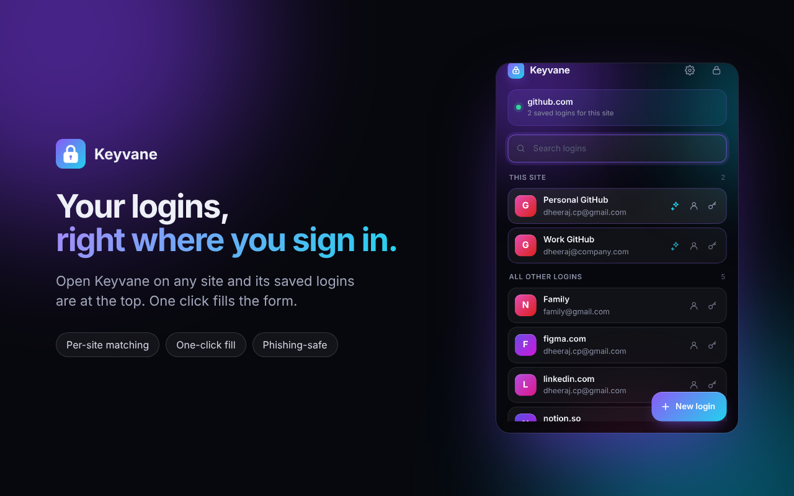

# Keyvane

**A free, end-to-end encrypted password manager for Chrome.** No account, no servers, no tracking.

[Install from the Chrome Web Store](https://chromewebstore.google.com/detail/occfjinobiaefhbkngbolamflknedmlo) · [Website](https://keyvane.vercel.app) · [Privacy policy](https://keyvane.vercel.app/privacy)



## What it does

- **Saves logins as you sign in** (opt-in), and offers to update them when a password changes. Handles single-page apps and two-step logins.
- **One-click fill**, only on the site a login belongs to.
- **Password generator** with a strength meter, plus weak and reused password counts.
- **Syncs through your Chrome sign-in** (`chrome.storage.sync`). Edits on two computers merge instead of overwriting.
- **Imports CSV** exports from Chrome, Edge, Brave, Firefox, Safari, Bitwarden, LastPass, 1Password, Dashlane and Proton Pass.
- **Encrypted backup** export and import, auto-lock, master password change.

## How the encryption works

| Step | What happens |
|---|---|
| Key | Master password → PBKDF2-SHA256, 600,000 iterations, 16-byte random salt → 256-bit key |
| Vault | JSON → gzip → AES-256-GCM with a fresh 12-byte random IV on every save |
| Storage | Only `{salt, iv, ciphertext}` is written, split into 7 KB chunks in `chrome.storage.sync` |
| Session | The unlocked key lives in `chrome.storage.session` (memory only, extension-only access) and is cleared on lock, auto-lock or browser close |
| Network | The extension CSP sets `connect-src 'none'`: Keyvane cannot make network requests |

The master password is never stored. There is no recovery: forget it and the vault cannot be decrypted by anyone.

All cryptography uses the browser's Web Crypto API. The code is in [`extension/crypto.js`](extension/crypto.js).

## Repository layout

```
extension/   the Chrome extension (Manifest V3, no build step, no dependencies)
  crypto.js      key derivation, encryption, password generator
  store.js       chunked vault storage on chrome.storage.sync
  vaultops.js    shared vault logic, CSV import, "known logins" index
  popup.*        the toolbar popup UI
  background.js  service worker for the opt-in "offer to save" feature
  content.js     notices login form submits (only when offer-to-save is on)
site/        keyvane.vercel.app (static, deployed on Vercel)
store/       Chrome Web Store screenshots and promo images
```

## Run it locally

1. Clone this repo.
2. Open `chrome://extensions`, turn on **Developer mode**, click **Load unpacked** and pick the `extension` folder.

## Permissions

| Permission | Why |
|---|---|
| `storage` | Save the encrypted vault and settings |
| `activeTab` | Read the current tab's address when you open the popup, to show matching logins |
| `scripting` | Fill a login into the page when you click Fill |
| `<all_urls>` (optional) | Requested only when you turn on "Offer to save passwords", to notice login form submits |

## Reporting security issues

See [SECURITY.md](SECURITY.md).

## License

[MIT](LICENSE)
